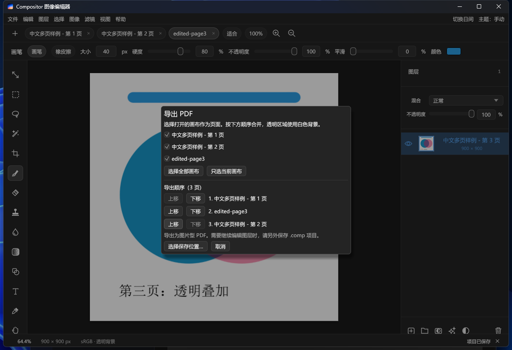

<p align="center">
  
</p>

<h1 align="center">CompositorWin</h1>

<p align="center"><strong>从图层开始，完成你的下一张作品。</strong></p>
<p align="center">面向 Windows 的中文图像编辑器 · 绘画与合成 · 照片处理 · 本地 AI Agent 操作</p>

<p align="center">
  
  
  
  <a href="LICENSE.md"></a>
</p>

<p align="center">
  <a href="https://github.com/shuguang-liming/CompositorWin/releases/latest"><strong>下载 Windows 版</strong></a>
  · <a href="#使用">快速开始</a>
  · <a href="#cli-与-ai-agent">AI Agent 与 CLI</a>
  · <a href="#开发">从源码构建</a>
  · <a href="https://github.com/shuguang-liming/CompositorWin/issues">反馈问题</a>
</p>

---

<p align="center">
  
</p>

## 为图像创作准备的工具

将图片放进画布，用图层和蒙版组合内容，继续绘画、排字、调色，再导出成品。需要重复操作时，同一个 EXE 也能通过 CLI 和 AI Agent 完成编辑。

| 你想做的事 | CompositorWin 提供的工具 |
|:---|:---|
| 把素材组合成一张作品 | 图层、蒙版、混合模式，保留可继续编辑的 `.comp` 工程 |
| 在画面上绘画、标注与排版 | 画笔、选区、文字、形状，以及撤销与重做 |
| 调整照片的观感 | Camera Raw、调色与滤镜，预览后应用 |
| 保留细腻渐变与亮部 | 16 位 PNG/TIFF、HDR/EXR 图层，保存工程后继续编辑 |
| 交付印刷图片 | 自选 CMYK ICC、软打样、色域警告，导出 CMYK JPEG/TIFF/PDF |
| 抠出主体，继续修边 | 内置 U²-Netp 离线主体分割，生成可编辑蒙版 |
| 修改 PDF 页面或合并成册 | 按页转为图片，使用绘图工具修改，再选择页序导出 PDF |
| 把重复步骤交给 Agent | CLI、JSONL 会话与当前窗口编辑，附操作技能和中文教学技能 |
| 换一个舒服的工作环境 | 简体中文界面、跟随系统的日夜模式、可导入与导出的自定义主题 |

## 下载与文件格式

| 选择 | 获取方式 |
|:---|:---|
| **安装版** | [下载 Setup EXE](https://github.com/shuguang-liming/CompositorWin/releases/download/v0.0.4/Compositor-Windows-0.0.4-Setup-x64.exe) · 当前用户安装，支持覆盖升级与卸载 |
| **便携版** | [下载 ZIP](https://github.com/shuguang-liming/CompositorWin/releases/download/v0.0.4/Compositor-Windows-0.0.4-x64.zip) · 解压后运行 `compositor.exe` |
| **源代码** | [查看发布记录](https://github.com/shuguang-liming/CompositorWin/releases) · [构建说明](#开发) |

当前版本为 **0.0.4**，保留原版 1.5.3 的图像编辑与交互改进；1.5.3 是原项目版本，Windows 版使用独立版本号。PDF 页面图片化编辑自 0.0.2 起提供，0.0.4 新增明确的“打开 PDF”入口；旧版 0.0.1 不包含此功能。完整功能与限制见 [迁移对照](docs/UPSTREAM_1.5.3.md)。

### 0.0.4 更新内容

1. 文件菜单和欢迎页新增“打开 PDF”，选择页码和清晰度后即可使用绘图工具修改页面。
2. 搜索“打开 PDF”“导入 PDF”或“Open PDF”可以直接找到导入入口。
3. 更新 PDF 使用说明，并将“导入、修改、保存、导出、重新打开”的完整检查加入发行包验证。

### 0.0.3 更新内容

1. 支持 16 位 PNG/TIFF 和 HDR/EXR 图层，编辑、保存和导出时保留更多颜色与亮部细节。
2. 新增 CMYK 软打样、色域警告和 JPEG/TIFF/PDF 印刷输出，支持导入 8 位 CMYK PSD/PSB。
3. 改善 Camera Raw 大图处理，保持原图分辨率预览，加快直方图统计；RAW 导入增加传感器降噪和高光恢复。
4. 新增扫描线、渐进模糊和平滑圆角，更新修复与内容填充算法。
5. 新增命令搜索、画布单独显示、重复上次滤镜、90° 旋转、导航小地图和图片文件夹导入。
6. 改善 Windows 图形初始化和显卡异常恢复，同步补齐 CLI 与 Agent 技能；主程序采用 Apache-2.0，开发脚本统一为 `project.ps1`。

| 格式 | 打开 / 导入 | 保存 / 导出 |
|:---|:---|:---|
| `.comp` 工程 | 单文件工程，兼容旧版目录工程 | 单文件，保留图层、蒙版与可编辑文字 |
| PNG、JPEG、TIFF、BMP、WebP、GIF | 支持 | 合成图像；JPEG 不保留透明，GIF 为单帧 |
| PNG / TIFF 16 位 | 保留 16 位原像素 | 可选 8 位或 16 位 |
| OpenEXR / Radiance HDR | 保留 HDR 亮部，EXR 按线性 sRGB/Rec.709 色度读取 | OpenEXR；自定义 EXR 色度暂未转换 |
| PSD / PSB | 支持 8-bit RGB / CMYK，复杂内容可能转换或栅格化；缺少有效 CMYK ICC 时提示近似转换 | 暂不支持 |
| SVG | 栅格化导入 | 暂不支持矢量导出 |
| PDF | 选择页码与 DPI，每页转为独立图片文档 | 当前页或按指定顺序合并的多页图片型 PDF |
| 相机 RAW | 取决于相机数据库 | 通过普通图片格式导出处理结果 |
| HEIC / HEIF | 需要兼容的 Windows 编解码器，部分文件需要 HEVC | 暂不支持 |

**运行环境：**Windows 10 22H2 / Windows 11 x64。正式包无需另装 Visual C++ 运行库；优先使用 Direct3D 12 / Vulkan，初始化失败时尝试 OpenGL 界面与 CPU 合成。当前回归验证在 Windows 11 完成，Windows 10 22H2 仍缺少实机验证，具体显卡驱动与格式限制见下方指南。

---

<!-- USER-GUIDE-BEGIN -->
# Compositor Windows 简体中文版

当前版本：**0.0.4**。文件菜单和欢迎页均可直接“打开 PDF”，支持选页、绘图修改和重新导出；保留高位深、HDR、CMYK、新滤镜和导航工具。文末保留此前 1.0.x 的更新记录。

PDF 编辑与导出自 0.0.2 起提供。0.0.4 可选择“文件 → 打开 PDF…”或欢迎页“打开 PDF”；0.0.2／0.0.3 可用“文件 → 打开…”选中 PDF。如果只有导出相关提示，请在 `compositor.exe` 的“属性 → 详细信息”核对产品版本，并用新版安装包升级或运行新版便携目录中的 `compositor.exe`。

支持图层、蒙版、绘画、选区、文字、形状、调色和滤镜的桌面图像编辑器，使用 Rust、egui 和 wgpu。

## 使用

可以运行 `Compositor-Windows-0.0.4-Setup-x64.exe` 安装，也可以解压发行 ZIP，直接双击 `compositor.exe`。需要 Windows 10 22H2/Windows 11 x64。程序优先使用 Direct3D 12 或 Vulkan；如果旧驱动无法创建 WGPU 设备，会自动切换 OpenGL 界面和 CPU 合成，避免启动后立即退出。正式发行程序静态链接 MSVC 和 Universal C 运行库，无需另行安装 Visual C++ 运行库。普通使用无需 Rust、Python 或独立 ONNX Runtime。

安装版仅安装到当前用户的 `%LOCALAPPDATA%\Programs\Compositor`，无需管理员权限，并提供桌面、开始菜单快捷方式。在 Windows“设置 → 应用”中卸载 Compositor，或运行安装目录里的卸载器。卸载只处理安装器登记的本软件文件、快捷方式和注册项；用户的 `.comp` 工程、设置及额外文件保留，其他目录不作清理。

发生启动、显卡初始化或图片读取异常时，可查看程序目录下的 `preferences/diagnostics.log`。日志仅保存在本地，限制文件大小，不会自动上传；可能包含图片路径、尺寸和显卡信息，分享前可先检查内容。

如果已安装此前的 1.0.x 版本，请先保存工程并卸载旧版，再安装 0.0.4；卸载会保留用户工程、设置和自行添加的文件。安装器会拒绝将较高版本号直接覆盖为较低版本号。

更新安装版时，先保存工程并关闭 Compositor，再双击新版安装 EXE。安装器识别已有版本，在原位置升级，保留工程、设置和自行添加的文件；同版可重新安装，旧版安装包会拒绝降级。如果程序文件正在使用或被修改，会在覆盖前停止，按提示处理后重新运行新版安装包。升级完成后使用新的卸载器。便携版更新时解压新版 ZIP，保留自己的工程和 `preferences` 设置。

1. 从欢迎页或“文件”菜单新建画布、打开项目或导入图片。
2. 在图层面板选择图层或蒙版，再用工具栏编辑。选区工具的 `Shift` 添加选区，`Alt` 减去选区。
3. `Ctrl+Z` 撤销，`Ctrl+Shift+Z` 重做；滤镜预览通过“应用”提交，也可以取消。
4. `Ctrl+S` 保存，`Ctrl+Shift+S` 另存为。`.comp` 是单个工程文件，内含图层、蒙版、可编辑文字与图片，分享或备份只需复制这一个文件。旧版文件夹工程仍可打开，保存时会另存为单文件，默认建议“原名-单文件.comp”。
5. 选择“文件 → 导出…（格式／尺寸／位深）”，选择 PNG、JPEG、TIFF、BMP、WebP、GIF、PDF 或 OpenEXR。可以调整输出尺寸；PNG/TIFF 可选 16 位，EXR 保留 HDR。JPEG 不保留透明背景。导出尺寸只影响成品，编辑工程保持原尺寸。
6. 右上角“切换日间／切换夜间”按钮切换界面明暗；旁边的“主题”菜单可选择“跟随系统／日间模式／夜间模式”。默认跟随 Windows 应用主题，系统设置变化时自动更新，手动选择会保存。主题只影响界面，不改变图片和导出颜色。

界面开启和关闭时有短暂淡入、淡出，工具按钮和标签切换也有过渡。关闭前仍会确认未保存的工程；在 Windows“辅助功能 → 视觉效果”中关闭“动画效果”时，这些过渡会立即完成。大图计算在后台执行，空闲时按事件重绘。

导入支持 PNG、JPEG、TIFF、BMP、GIF、WebP、SVG、OpenEXR、Radiance HDR、受支持的相机 RAW、PSD/PSB 和 HEIC/HEIF。可以导入普通图片文件夹，按自然文件名顺序读取直接子文件，不递归子目录。PSD/PSB 支持 8 位 RGB／CMYK，复杂内容可能转换或栅格化，打开时显示转换报告；缺少有效 CMYK ICC 时会提示颜色采用近似转换。当前没有 PSD/PSB 导出。HEIC/HEIF 依赖兼容的 Windows 编解码器，部分图片需要 HEVC。RAW 支持范围取决于相机数据库，正式导入保留 16 位颜色。

16 位 PNG/TIFF 和 HDR 图层保留高精度原像素；图层菜单可转换 8 位、16 位或 HDR。转为 8 位会减少颜色精度并裁切超白亮部，可以撤销。EXR 按线性 sRGB/Rec.709 色度读取，自定义 EXR 色度暂未转换；带 ICC 且颜色超出 0–1 的浮点图像会明确提示转换限制。显示器预览为普通动态范围，高精度合成目前在 CPU 后台进行。

印刷输出前在“视图”选择印刷厂提供的 CMYK ICC 配置，再按需打开软打样或色域警告；导出窗口选择 JPEG、TIFF 或 PDF 后勾选 CMYK。透明区域铺白，文件内嵌所选配置。这是图片型印刷输出，不是 PDF/X。RAW 打开时可调整传感器降噪和高光恢复，并记住上次设置；当前 RAW 解码器未提供镜头配置，自动镜头校正入口保持禁用。

主体选择与移除背景使用内嵌 U²-Netp 离线模型，通过可编辑蒙版保留原始像素。细发丝、毛发、半透明对象和复杂主体可能需要手工修正。界面参考原 macOS 项目；字体、RAW、主体分割与部分视觉效果存在平台差异。大图及多图层受可用内存限制，请及时保存。

## PDF 页面图片化编辑

页面会先转为图片，再使用现有绘图工具编辑。

1. 选择“文件 → 打开 PDF…”或欢迎页“打开 PDF”，选中 PDF；也可使用 `Ctrl+O` 或拖放。在“打开 PDF 页面”对话框填写页码，例如 `1,3-5`。页码从 1 开始，选中的页面按原文档顺序打开。
2. 选择清晰度：默认 **300 DPI**，还可选择 72、150 或 600 DPI。日常查看可用 150 DPI，需要文字与细线细节可用 300 DPI；较高 DPI 和更多页面会占用更多内存，页面过大时降低 DPI 或分批打开。
3. 点击“打开页面”。每页成为一个独立标签页，可以用画笔、文字、形状、图层和蒙版修改。要把一页叠到现有画布上，使用“文件 → 导入为图层…”，每次选择一页。
4. 按 `Ctrl+S` 将需要继续编辑的页面分别保存为 `.comp` 工程。保存工程不会写回原 PDF，也不会自动把所有标签页存进一个工程。
5. 选择“文件 → 导出 PDF（可合并多页）…”，勾选要输出的已打开画布，用“上移／下移”调整顺序，再选择保存位置。既可导出一页，也可把多页或普通图片画布合成一个 PDF；只导出当前页时也可在“导出…（格式／尺寸／位深）”中选择 PDF。

导出为**图片型 PDF**，透明区域使用白色背景。原页面的可见内容转为像素；原有文字、矢量、链接、表单与数字签名结构不保留，导出后不再具有原 PDF 的文字搜索、链接或表单功能。新增文字可以在 `.comp` 工程中继续编辑，导出 PDF 时合并为页面图片。需要保留原件时，请使用新的导出文件名。

## 自定义主题与 AI 制作

打开“视图 → 主题设置…”或右上角“主题 → 主题设置…”。在这里可导入、导出主题，并选择“使用原版主题”或“使用自定义主题”。自定义主题只修改软件界面配色，不修改图片、导出颜色、字号或布局。每个主题都包含日间和夜间两套配色，右上角的“跟随系统／日间模式／夜间模式”仍决定实际使用哪套。

1. 点击“导出主题…”，保存为 `theme.json`。首次制作时可先选择原版主题，导出一份完整模板。
2. 把模板内容和下方提示词交给任意 AI 工具，说明喜欢的颜色、风格或参考图。主题制作无需插件、API key 或运行脚本。
3. 将 AI 返回的 JSON 保存为 UTF-8 编码的 `.json` 文件，例如 `my-theme.json`。只保存 JSON 内容，去掉 Markdown 代码围栏和解释文字。
4. 点击“导入主题…”，选择该文件；通过检查后立即应用。主题内容会保存在软件设置中，重启仍有效，随后移动或删除原 JSON 不影响已导入主题。
5. 不满意时可重新导入调整后的文件，或点击“使用原版主题”；原版切换会保留已导入的自定义主题，随时可切回。“导出主题…”导出当前正在使用的主题，方便分享、备份或继续修改。

可直接复制给 AI 的提示词：

<details>
<summary><strong>展开 AI 提示词、完整主题模板与字段说明</strong></summary>


```text
请为 Compositor Windows 制作自定义主题。我会在本提示词后粘贴从软件导出的 theme.json。
我喜欢的风格：[填写，例如低饱和森林绿、暖纸色日间和墨绿夜间；可附参考图]。
只返回可直接保存的完整 JSON，不要解释、Markdown 围栏、注释或其他文件。无需插件或脚本。
严格保留根字段 version、name、palettes；version 为整数 1；name 为 1～64 个字符，不含控制字符。
palettes 必须同时有 dark 和 light，每套必须且只能包含以下 16 个字段：
shell、canvas、field、text、secondary_text、disabled_text、divider、checker_light、checker_dark、
thumb_checker_light、thumb_checker_dark、ruler_fill、ruler_tick、ruler_text、ruler_divider、accent。
所有颜色使用不含透明度的 #RRGGBB；不能添加字段、遗漏字段或改变结构。完整 UTF-8 文件不超过 64 KiB。
dark 和 light 分别为夜间和日间配色。每套中 text 对 shell、text 对 field 的 WCAG 对比度均至少 4.5:1。
保持次要文字、标尺文字、选中高亮和透明棋盘格清晰；界面颜色不要干扰对照片颜色的判断。
只修改配色和主题名称，不改图片颜色、字号或布局。输出前检查字段、JSON语法和两套主文字对比度。
以下是导出的模板：
[在此粘贴 theme.json 的完整内容]
```

完整可用模板如下；也可以直接复制保存为 `theme.json` 后交给 AI 修改：

```json
{
  "version": 1,
  "name": "原版配色模板",
  "palettes": {
    "dark": {
      "shell": "#242424",
      "canvas": "#1B1B1B",
      "field": "#1F1F1F",
      "text": "#EBEBEB",
      "secondary_text": "#A0A0A0",
      "disabled_text": "#646464",
      "divider": "#373737",
      "checker_light": "#595959",
      "checker_dark": "#4D4D4D",
      "thumb_checker_light": "#525252",
      "thumb_checker_dark": "#383838",
      "ruler_fill": "#333333",
      "ruler_tick": "#9E9E9E",
      "ruler_text": "#C7C7C7",
      "ruler_divider": "#141414",
      "accent": "#5097DF"
    },
    "light": {
      "shell": "#F5F5F5",
      "canvas": "#D8D8D8",
      "field": "#FFFFFF",
      "text": "#232323",
      "secondary_text": "#646464",
      "disabled_text": "#9B9B9B",
      "divider": "#D2D2D2",
      "checker_light": "#F2F2F2",
      "checker_dark": "#DCDCDC",
      "thumb_checker_light": "#E6E6E6",
      "thumb_checker_dark": "#CDCDCD",
      "ruler_fill": "#E9E9E9",
      "ruler_tick": "#6E6E6E",
      "ruler_text": "#414141",
      "ruler_divider": "#B4B4B4",
      "accent": "#2370BE"
    }
  }
}
```

`shell` 是面板与窗口底色，`canvas` 是画布外背景，`field` 是输入区域底色，`text` 是主文字，`secondary_text`／`disabled_text` 是次要／禁用文字，`divider` 是分隔线，`accent` 是选中与强调色。`checker_light`／`checker_dark` 控制画布透明棋盘格，`thumb_checker_light`／`thumb_checker_dark` 控制缩略图透明棋盘格；`ruler_fill`／`ruler_tick`／`ruler_text`／`ruler_divider` 分别控制标尺背景、刻度、文字和边线。

导入会拒绝未知版本或字段、缺失字段、错误颜色、非 UTF-8、超过 64 KiB 或主文字对比度不足的文件。按界面提示修正，再重新导入；可以把错误提示与原 JSON 一起交给 AI。照片区域仍需要中性环境时，让 AI 降低 `canvas` 和棋盘格的饱和度。需要多个风格时，让 AI 分次生成完整 JSON，分别保存；软件一次使用一份自定义主题。

</details>

## CLI 与 AI Agent

同一个 `compositor.exe` 内置本地 CLI，可由脚本和 AI Agent 新建画布、导入素材、编辑图层、离线抠图、保存工程和导出图片。离线命令与 `serve` 不启动窗口或 GPU，`live` 可直接编辑已打开的窗口；无需远程模型或 API key。操作名称、参数和支持格式用 `cli capabilities`（别名 `cli schema`）查询。

| 命令 | 用途 |
|---|---|
| `cli capabilities` | 返回协议、命令与编辑操作参数清单及示例 |
| `cli fonts` | 查询本机文字可用字体名称 |
| `cli pdf-info INPUT.pdf` | 查看 PDF 页数与页面尺寸 |
| `cli pdf-open INPUT.pdf --page 2 --dpi 150 --output page2.comp` | 将指定页转为可编辑工程 |
| `cli inspect INPUT` | 检查项目或图片，读取图层 ID 与指纹 |
| `cli new --width 1920 --height 1080 --output work.comp` | 创建分层工程 |
| `cli apply INPUT --output work.comp --operations @operations.json` | 批量编辑，整批成功才保存 |
| `cli export INPUT --output image.png` | 按扩展名导出图片或单页 `.pdf` |
| `cli serve` | 通过 JSONL 持续编辑，支持撤销和重做 |
| `cli live inspect` | 检查当前窗口的文档，包括未保存修改 |
| `cli live METHOD --params @params.json` | 编辑当前窗口、撤销、重做、保存或导出 |
| `cli skill install` | 安装内嵌的 `compositor-editor` 技能 |
| `cli skill show` | 查看完整技能原文 |

PDF 命令先通过 `cli capabilities` 确认程序支持：`methods` 含 `pdf-info`、`pdf-open`，`exportFormats` 含 `pdf`。CLI 每次打开一页，必须显式给出从 1 起的 `--page` 和 72–600 的整数 `--dpi`；直接对 PDF 执行 `inspect`、`apply` 或 `export` 时也需这两个参数。多页可逐页处理；选择页面、调整页序并合并导出使用上方界面流程。`live` 仅操作已打开的文档，PDF 需先在界面导入。

`operations.json` 是 UTF-8 JSON 数组，例如导入素材后生成主体蒙版：

<details>
<summary><strong>展开命令示例、JSON 协议与 Agent 技能安装说明</strong></summary>


```json
[
  {"op": "import_layers", "paths": ["C:/Pictures/input.png"]},
  {"op": "subject_mask", "replace_existing": true}
]
```

操作坐标与界面一致，画布左上为原点，x 向右、y 向下；图层可通过 `inspect` 返回的 ID 指定，省略表示活动图层。`apply` 可加 `--expected-fingerprint HASH`，确保输入未被其他进程修改。导出可加 `--max-side 1024` 生成预览、`--quality 90` 设置 JPEG 质量；需要覆盖已有目标时加 `--overwrite`。文字样式的 `fontName` 使用 `cli fonts` 返回的名称。打开与导入返回的 `warnings` 说明实际格式转换。`project_busy` 表示目标正在被其他进程读写，等待后先重新检查项目，再决定是否重试。

Windows 发行 EXE 采用 GUI 子系统，终端调用应等待进程并捕获输出。以下 Python 示例在发行文件夹内运行，直接传参数列表，支持中文及带空格路径：

```python
import json
import subprocess
from pathlib import Path

exe = str(Path("compositor.exe").resolve())

def cli(*args):
    run = subprocess.run([exe, "cli", *map(str, args)],
                         capture_output=True, encoding="utf-8")
    reply = json.loads(run.stdout)
    if run.returncode != 0 or not reply.get("ok"):
        raise RuntimeError(reply.get("error", run.stderr))
    return reply["result"]

print(cli("capabilities"))
print(cli("skill", "install"))
# cli("new", "--width", 1920, "--height", 1080, "--output", "work.comp")
# cli("apply", "work.comp", "--output", "edited.comp", "--operations", "@operations.json")
# cli("export", "edited.comp", "--output", "preview.png", "--max-side", 1024)
```

Python 仅用于这个调用示例，其他语言也可直接启动进程。控制输出统一为 UTF-8 JSON，成功含 `protocolVersion`、`ok: true`、`result`，失败含 `ok: false`、`error.code` 与 `error.message`；`skill show` 输出 Markdown 原文。日志写入 stderr。

`cli serve` 每行接受 `{ "id": 1, "method": "open", "params": { "path": "work.comp" } }`，每行返回一个响应并回显 `id`。方法包括 `capabilities`、`fonts`、`pdf-info`、`pdf-open`、`open`、`new`、`inspect`、`apply`、`undo`、`redo`、`save`、`export`、`close`。`open` 或 `pdf-open` 读取 PDF 时使用 `{"path":"input.pdf","page":2,"dpi":150}`。`apply` 接受 `params.operations` 数组及可选 `expectedRevision`，`save` 使用 `params.path` 与 `params.overwrite`，`export` 使用 `path`、可选 `maxSide`、`quality` 和 `matte`。会话编辑先保存在内存，调用 `save` 才写盘；选区与撤销历史不写入 `.comp`。

直接操作当前窗口时，先运行 `cli live capabilities` 获取会话，再用 `cli live inspect` 读取 `sessionId`、`revision` 与 `serial`。`live` 支持 `inspect`、`apply`、`undo`、`redo`、`save`、`export`；编辑参数包含 `operations` 数组，并带上 `sessionId`、`expectedRevision`、`expectedSerial`，保护读取后又发生的界面变更。保存与导出使用 `path`，导出预览可加 `maxSide:1024`；一次 `apply` 作为一个撤销步骤。

`live` 保存默认拒绝所有已有目标，包括当前项目路径；明确覆盖时设置 `overwrite:true`，可同时用 `expectedFingerprint` 检查磁盘目标。撤销、重做、保存和导出也接受上述会话版本条件；冲突后重新检查，交互忙碌时等待。导出不会标记项目已保存。若有多个窗口，使用 `--endpoint` 选择客户端报告的 endpoint 文件。请求超时后先检查文档或目标文件，后台操作可能已完成。

技能默认安装到 `~/.codex/skills/compositor-editor/SKILL.md`（设置 `CODEX_HOME` 时使用该目录下的 `skills`），也可用 `cli skill install --path SKILL_FOLDER` 指定技能文件夹。安装会记录 EXE 位置；软件移动后重新安装即可。相同内容重复安装不新增备份；不同内容先备份为同目录 `SKILL.md.<uuid>.bak`，响应的 `backup` 字段给出位置，保留原有定制。

让 Codex 刷新技能列表或打开新聊天后，使用 `$compositor-editor`，例如“把这张图抠掉背景，保存可编辑工程并导出透明 PNG”或“直接把当前窗口图层的透明度调低”。Agent 会先发现能力，再执行编辑、导出预览并检查结果。离线保存会触发已打开 `.comp` 的外部重载，有未保存修改时会请求确认；`live` 直接更新界面文档。

</details>

### 让 AI 教你使用软件

发行包根目录的 `USER_AGENT_SKILL.md` 是面向普通用户的中文教学技能。它专门回答界面、快捷键、导入、保存、导出、PDF 图片化编辑、图层、蒙版、抠图、Camera Raw、主题和 CLI 的使用问题，会先检查实际程序是否支持所需功能。

把这个文件复制到你使用的 Agent 技能目录，并放在名为 `compositor-user-guide` 的文件夹中：

```text
~/.codex/skills/compositor-user-guide/SKILL.md
```

也可以在支持“导入技能”的 Agent 界面中直接选择 `USER_AGENT_SKILL.md`。刷新技能列表或打开新聊天后，使用 `$compositor-user-guide`，例如：

- “一步一步教我把 JPG 导入 Compositor，抠出人物并导出透明 PNG。”
- “Ctrl+S 保存的是什么？我想要 JPG 应该从哪里导出？”
- “教我用图层蒙版和 Camera Raw 做一张照片。”
- “我只想学习操作，不要替我修改文件。”

`Ctrl+S` 只保存可继续编辑的 `.comp` 工程；需要图片成品时使用 `文件 → 导出…（格式／尺寸／位深）`，原有 PNG/JPEG/TIFF 快捷入口也保留。PNG/TIFF 支持 16 位，OpenEXR 保存 HDR；JPEG 不保留透明，GIF 是单帧导出并受调色板限制。CLI 的 JSONL `export` 方法可传 `bitDepth:16` 或 `cmykProfile`；一次性导出对应 `--bit-depth 16`、`--cmyk-profile <ICC路径>`。能力与参数以当前程序 `cli capabilities` 返回值为准。

<details>
<summary><strong>展开此前 1.0.x 版本的更新记录</strong></summary>

## 1.0.5 更新说明

- 正式发行程序静态链接 C/C++ 运行库，修复没有安装 `VCRUNTIME140.dll` 时程序启动失败的问题。
- 降低 PSD/PSB 解析过程中的临时内存占用，减少大型分层文件导入时的内存压力。
- 新增有大小限制的本地诊断日志，记录启动、显卡初始化和图片读取错误，便于排查异常。
- 画布预览改为按原图像素渲染当前可见区域；100% 查看保留黑白细节，超大图只上传视口，避免固定低分辨率预览造成模糊。
- Camera Raw 曲线和参数预编译并行处理；750,000 像素基准的 6 组结果平均约快 4 倍，输出逐字节保持一致。
- Camera Raw 拖动和松开参数都使用原图源生成结果；后台按最新参数合并请求，避免拖动过程排队处理每个中间值。
- 导入前按物理内存计算解码像素预算，避免 Win10 小内存机器在 JPG/PSD 解码临时拷贝阶段耗尽内存。
- PSD/PSB 合成图像只保留 RGB(A) 通道；智能对象和图层效果等仅作标记，不再复制未解析的大型资源体。
- 启动前探测全部 DX12/Vulkan 适配器，低端或异常驱动自动切换 OpenGL/CPU 路径；设备纹理上限跟随适配器，兼容 4096 级别的旧驱动。
- 嵌入 Windows 10/11 清单，过滤未编译的 `WGPU_BACKEND` 值，并补充安装器的 x64/Windows 10 前置检查。

## 1.0.3 更新说明

- 优化 CPU 多核处理、后台加载和 GPU 缓存，减少大图操作中的等待和重复计算。
- 加入窗口开启／关闭淡入淡出及按钮／标签过渡，并遵循 Windows 的动画效果设置。
- 新增自定义主题：导入、导出完整日夜配色，并在原版与自定义主题之间切换。
- 新增 AI 制作主题指南、完整 JSON 模板和可直接复制的提示词，发行包只需阅读本 README。
- 自定义主题直接应用并保存在设置中，重启和覆盖升级保留；继续支持跟随系统及手动日夜切换。
- 加入主题格式、文件大小和主文字对比度检查，错误主题在应用前给出提示。

</details>

CompositorWin 主程序采用 [Apache License 2.0](https://www.apache.org/licenses/LICENSE-2.0) 开源，原项目 [robbietilton/Compositor](https://github.com/robbietilton/Compositor) 的版权和 MIT 许可完整保留。在软件中打开“帮助 → 开源软件许可证”，点击组件名称可在线查看许可证，点击“随附原文”可离线阅读原始版权和许可；原项目、模型、依赖和字体仍分别适用各自许可证。发行包的 [LICENSES.md](LICENSES.md) 提供简短入口说明，完整原文保存在软件内。
<!-- USER-GUIDE-END -->

## 致谢与开源许可

CompositorWin 主程序及 Windows 移植新增代码采用 **Apache License 2.0**，许可证见 [LICENSE.md](LICENSE.md)。Windows 版基于 [robbietilton/Compositor](https://github.com/robbietilton/Compositor) 的设计与项目工作，使用 Rust、egui 与 wgpu 实现。原项目代码保留原作者 **Wonder Assembly LLC** 的版权及 MIT 许可；U²-Netp 模型、字体与其他第三方依赖分别遵循各自许可证。

完整版权与许可原文统一在 [LICENSES.md](LICENSES.md)。软件内可打开 **帮助 → 开源软件许可证**，通过在线链接查看各组件许可，也可按需展开随附原文。

源码中的 Agent 技能分别见[编辑操作技能](skills/compositor-editor/SKILL.md)与[中文教学技能](skills/compositor-guide/SKILL.md)。

## 开发

在根目录运行 Cargo。需要 Rust 1.99.0 MSVC、Microsoft C++ Build Tools、Windows SDK 和 MASM；打包与运行库审计使用 Python 3.11+。脚本使用 PATH 中的 Cargo 和现有 `CARGO_HOME`／`RUSTUP_HOME`，不固定安装目录。离线模式需要提前缓存锁定依赖。

```powershell
$env:RUST_TEST_THREADS = '1'
New-Item -ItemType Directory -Force build/validation/current | Out-Null
.\project.ps1 Build -Action All -Offline -Jobs 1 *> build/validation/current/all.log
```

`All` 依次运行 fmt、所有目标 check、严格 Clippy、测试和 Release 构建；EXE 在 `build/rust/release/compositor.exe`。也可以直接运行 `cargo check --locked --all-targets` 或 `cargo test --locked`。低内存机器使用 `-j 1` 限制编译并发。

开发和测试配置默认关闭增量编译缓存，避免频繁切换构建累积大量磁盘占用。统一入口的全部实际子命令（含打包、运行库审计和许可证生成）将编译输出及进程级 `TEMP`／`TMP` 放在项目的 `build/` 下；将工程放在 D 盘即可让这些文件留在 D 盘，不修改 Windows 全局临时目录。直接运行 Cargo 时需自行设置临时目录。Rust 工具链和依赖缓存的位置分别由 `RUSTUP_HOME`、`CARGO_HOME` 决定。

所有开发脚本已合并为根目录的 `project.ps1`，运行 `.\project.ps1 Help` 查看命令。`Build` 的 Release、All 和 Package 构建只为 Release 临时追加 `-C target-feature=+crt-static`，随后恢复原编译环境；check/test 使用原有参数与缓存。若直接调用 Cargo，需自行保留已有编译参数并追加静态 CRT 配置，再运行 `cargo build --locked --release --bin compositor`；发行前的运行库审计会拒绝直接或延迟依赖外部 CRT DLL 的 EXE。

`vendor/wgpu-hal` 固定为 crates.io 的 27.0.4（归档 SHA256：`5b21cb61c57ee198bc4aff71aeadff4cbb80b927beb912506af9c780d64313ce`，上游提交 `af91efa93da2af9366b252ed7b9a089175f4874e`）。仅修正 DX12 的 tearing 能力判断：查询成功后仍须检查返回的 BOOL，驱动报告不支持时不向交换链传入该标志。Cargo 通过根目录 `[patch.crates-io]` 使用这份源码，不修改全局依赖缓存；原始 Apache/MIT 许可随源码保留，完整版权原文也已收录于根目录 `LICENSES.md`。该补丁不增加运行时文件，也不改变软件版本。微软接口要求见[Variable refresh rate displays](https://learn.microsoft.com/en-us/windows/win32/direct3ddxgi/variable-refresh-rate-displays)。

完成新 EXE 的实际 GUI 检查后，审计并打包到新名称：

```powershell
.\project.ps1 AuditRuntime
.\project.ps1 Build -Action Package -Offline -Jobs 1 -PackageName Compositor-Windows-next
.\project.ps1 VerifyPackage -PackageName Compositor-Windows-next
.\project.ps1 VerifyPdf -ExePath dist/Compositor-Windows-next/compositor.exe
.\project.ps1 PackageInstaller -CompilerPath 'D:\Tools\nsis-3.11\makensis.exe' -PackageName Compositor-Windows-next -InstallerName Compositor-Windows-next-Setup-x64.exe
```

发行包写入 `dist/`，已存在的同名包会保留。`VerifyPackage` 自动检查包内程序的 PDF 导入、编辑、工程保存、PDF 导出及重新导入；也可用 `VerifyPdf` 单独检查指定 EXE，结果保存在 `build/validation/`。打包从本 README 提取使用说明，校验软件内压缩保存的完整许可原文，并生成简短的 `LICENSES.md` 入口说明；在线许可证在“帮助 → 开源软件许可证”中查看。安装包使用官方 NSIS 3.11 便携编译器；上方路径替换为本机 `makensis.exe`，不需要把编译器分发给用户。先验证便携包，再生成 `dist/Compositor-Windows-Setup-x64.exe`。安装脚本固定当前用户目录，卸载按登记文件验证归属后逐个移除，保留修改后的文件和用户数据。

Windows EXE 的图标和版本资源由 `build.rs` 调用 Windows SDK 的 `rc.exe` 编译，无新增运行依赖。原版高清图标与多尺寸 ICO 在 `assets/`，需要重新生成时运行 `.\project.ps1 GenerateIcon`（仅此开发步骤需要 Pillow）。许可资源校验运行 `.\project.ps1 GenerateLicenses --check`。Python 工具已内嵌在统一脚本中，相关子命令仍需要 Python 3.11+；可用全局参数 `-PythonPath` 指定解释器。构建记录与临时文件统一写入 `build/`，发行包写入 `dist/`，均被 Git 忽略。现有发行程序与源码检查记录是不同交付身份，不将旧程序测试当作新构建验证。

| 内容 | 位置 |
|---|---|
| 应用源码 | `src/` |
| 模型、图标、WGSL | `assets/` |
| 测试及参考数据 | `tests/` |
| 基准与开发例程 | `examples/` |
| 格式与主题文档 | `docs/` |
| Agent 操作与教学技能 | `skills/` |
| 安装配置与运行库索引 | `packaging/` |
| 构建、打包、校验与资源生成 | 根目录 `project.ps1` |
| 编译缓存、临时文件与验证记录 | `build/`，不提交 Git |
| 安装包与便携发行包 | `dist/`，不提交 Git |

`.comp` 默认写入单文件容器 v1；普通工程使用清单 11，16 位像素使用 12，HDR 使用 13，启用形状平滑圆角时使用 14。可读清单 1–14 与原 macOS 目录包，保存时保留高位深资产；旧目录包需另存成单文件。原 macOS 程序不直接读取 Windows 单文件容器。字段语义与 Agent 写入规则见 [PROJECT_FORMAT.md](docs/PROJECT_FORMAT.md)，迁移状态与平台差异见 [原版 1.5.3 对照](docs/UPSTREAM_1.5.3.md)。原 macOS 工程仅供参考，普通构建和测试不编译或调用原 Swift/C 应用。可选 C oracle 重新生成工具需要显式指定原工程；测试使用已保存的参考数据。

## 模型开发

`assets/u2netp.nnef.tar.gz` 是应用内嵌模型；`assets/u2netp.onnx` 是模型转换与单测输入。`examples/round2_legacy/` 是基准直接导入的参考源码，两者均属于工程文件。

模型工具并入同一 Cargo 工程，按需运行：

```powershell
cargo run --offline --locked --release -j 1 --target-dir build/rust --example prepare-model -- assets/u2netp.onnx build/models/u2netp.nnef.tar.gz build/validation/current/model-preparation.json
```

工具保留 float32 权重、`[1,3,320,320]` 输入及第一张输出；验证重复序列化字节一致，并要求 ONNX/NNEF 的 102,400 个 float32 输出逐位相等后才写入。CPU 内核选择和权重打包仍在运行时完成。更新 tract 时需要重新制作和验证模型；确认新模型后再替换内嵌资产。

| 模型 | SHA256 |
|---|---|
| 原 ONNX | `309c8469258dda742793dce0ebea8e6dd393174f89934733ecc8b14c76f4ddd8` |
| 当前 NNEF | `985102e3dc91799439440e570abee24dafbf9a31f260223819bee6ddf94a8931` |
